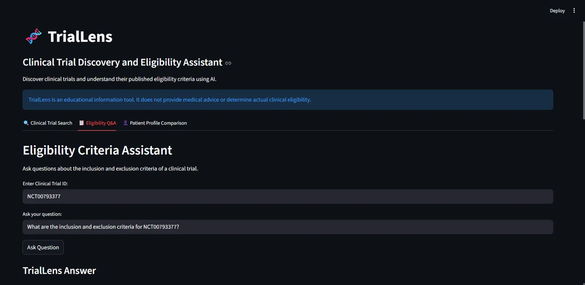
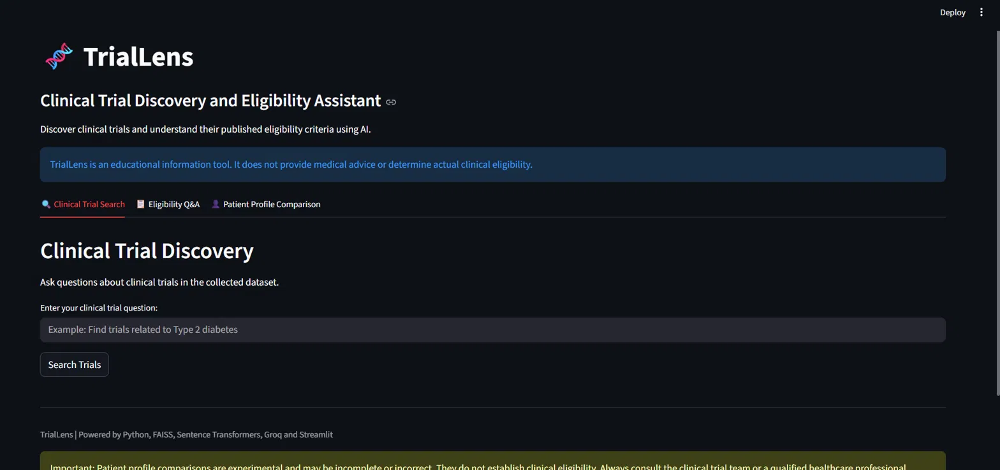

# 🧬 TrialLens: Clinical Trial Discovery & Eligibility Assistant

TrialLens is a Retrieval-Augmented Generation (RAG) application that helps people explore [ClinicalTrials.gov](https://clinicaltrials.gov) studies in plain language. It can search for trials, answer questions about a trial's inclusion and exclusion criteria, and compare a **synthetic** patient profile against published criteria. Answers are generated only from retrieved evidence, and the system is evaluated for both retrieval quality and claim-level faithfulness.

> ⚠️ **Educational prototype.** TrialLens does not provide medical advice, diagnose conditions, or determine real clinical eligibility. Recruitment status reflects the data snapshot that was collected and may have changed. Use synthetic information only; never enter real patient data.
> 
## Application Screenshots

### 1. Clinical Trial Search


### 2. Eligibility Q&A


### 3. Eligibility Q&A – Generated Answer


---

## Highlights

- **Three tools in one app:** trial search, eligibility Q&A by NCT ID, and patient profile comparison (Streamlit).
- **Evidence-grounded answers:** the LLM sees only retrieved trial text, runs at temperature 0, and is told to keep each NCT ID separate and never invent results.
- **Dataset-verified metadata:** status, phase, age, and sex shown to the user come straight from the collected data, not from the LLM.
- **Measured, not just demoed:** retrieval is scored on manually labeled queries, and every generated claim is checked against its evidence.

## Results at a Glance

| Metric | Result |
|---|---|
| Trials collected | 295 across 6 conditions |
| Indexed chunks | 1,525 (500-word chunks, 100-word overlap) |
| Embedding model | all-MiniLM-L6-v2 (384 dimensions) |
| Precision@5 | **0.80** (6 manually labeled queries) |
| MRR@5 | **1.00** |
| Claims verified | 163 claims from 6 generated answers |
| Supported / Contradicted / Not established | 152 / 0 / 11 (**93.25% supported**) |
| NCT ID consistency check | 6 of 6 answers passed |

See [Evaluation](#evaluation) for how these were measured and their limits.

---

## Features

### 1. Clinical Trial Search
Ask natural-language questions such as *"Find trials related to Type 2 diabetes."* The app retrieves the most relevant trials and returns an LLM-written overview, followed by trial details (status, study type, phase, age range, sex, source link) taken directly from the dataset.

### 2. Eligibility Q&A
Enter an NCT ID and ask a question such as *"What are the exclusion criteria?"* The answer is based on that trial's published eligibility text, with a link to the official record.

### 3. Patient Profile Comparison
Fill in a synthetic profile (age, sex, conditions, medications, previous treatments, history, measurements, allergies, pregnancy status). The app compares it with the trial's criteria and returns a table with, for each criterion, the relevant patient information, a result, and a reason:

| Result | Meaning |
|---|---|
| `no_apparent_conflict` | The supplied information does not conflict with the criterion |
| `potential_conflict` | The supplied information may conflict with the criterion |
| `cannot_assess` | Not enough information was provided to judge |

Missing information is reported as `cannot_assess` instead of being guessed.

---

## Architecture

```
ClinicalTrials.gov API (v2)
        |
        v
  Data collection  ->  Cleaning  ->  Section-based chunking (500 words, 100 overlap)
                                              |
                                              v
                         Sentence Transformers (all-MiniLM-L6-v2, normalized)
                                              |
                                              v
                              FAISS IndexFlatIP (cosine similarity)
                                              |
User query -> embed -> top-k search -> filters + section-aware ranking
                                              |
                                              v
                    Evidence context (up to 3 chunks per trial)
                                              |
                                              v
              Groq LLM (gpt-oss-20b, temperature 0, evidence-only prompt)
                                              |
                                              v
        LLM overview  +  trial metadata taken directly from the dataset
```

## How It Works

**1. Data collection.** The ClinicalTrials.gov API (v2) is queried for 6 conditions (Type 2 Diabetes, Breast Cancer, Cardiovascular Diseases, Asthma, Alzheimer Disease, Chronic Kidney Disease), up to 50 studies each. Records are deduplicated by NCT ID, giving 295 unique trials. Each record keeps title, summary, conditions, status, study type, phase, age limits, sex, dates, eligibility criteria, and source URL.

**2. Chunking.** Trial text is split by section (title, summary, conditions, status, eligibility) into 500-word chunks with 100-word overlap. Every chunk carries its trial metadata, producing 1,525 chunks.

**3. Embeddings and index.** Chunks are embedded with `all-MiniLM-L6-v2` (normalized) and stored in a FAISS `IndexFlatIP` index, so inner product equals cosine similarity.

**4. Retrieval.** The query is embedded and the index searched with a wider candidate pool than needed. Candidates are then:
- filtered by a minimum similarity score (0.30),
- filtered by condition (keyword mapping with synonyms) and recruitment status,
- restricted to title and summary chunks for general discovery queries, with eligibility chunks added when the query asks about criteria,
- ranked by similarity (section priority breaks ties), then grouped so the top trials are chosen by their best chunk, keeping up to 3 evidence chunks per trial.

**5. Grounded generation.** The prompt contains each trial's evidence under its own NCT ID and a strict rule set: use only supplied context, never transfer information between trials, never invent sample sizes or results, separate planned outcomes from actual findings, and report missing information as missing. The model runs at temperature 0. The final response appends a "trial details" block built directly from the dataset, so key metadata does not depend on the LLM.

**Design decisions**
- A regex word-boundary match prevents "Type 1" and "Type 2" diabetes from being confused.
- The patient comparison reports `cannot_assess` for missing data rather than assuming.
- If the LLM returns nothing, the app falls back to showing dataset-derived trial details.

---

## Evaluation

### Retrieval

For 6 test queries (one per condition), the top 10 retrieved trials were manually labeled relevant (1) or not (0). Metrics are computed on the top 5.

| Query | Condition | Relevant in pool | Relevant in top 5 | Precision@5 | Recall@5 | MRR@5 |
|---|---|---|---|---|---|---|
| Q1 | Type 2 Diabetes | 6 | 4 | 0.80 | 0.67 | 1.00 |
| Q2 | Breast Cancer | 10 | 5 | 1.00 | 0.50 | 1.00 |
| Q3 | Cardiovascular Diseases | 5 | 4 | 0.80 | 0.80 | 1.00 |
| Q4 | Asthma | 5 | 3 | 0.60 | 0.60 | 1.00 |
| Q5 | Alzheimer Disease | 8 | 5 | 1.00 | 0.63 | 1.00 |
| Q6 | Chronic Kidney Disease | 5 | 3 | 0.60 | 0.60 | 1.00 |
| **Average** | | | | **0.80** | 0.63 | **1.00** |

> Recall@5 is measured against the 10 labeled candidates per query, not every relevant trial in the dataset. When a query has more than 5 relevant candidates (for example Q2 with 10), recall@5 cannot exceed 0.5 even with perfect precision, so Precision@5 and MRR@5 are the more informative numbers here.

### Claim-level faithfulness

For each of the 6 generated answers (top 5 trials each), an LLM judge extracts individual factual claims and checks each one against the retrieved evidence, labeling it `SUPPORTED`, `CONTRADICTED`, or `NOT ESTABLISHED`. NCT IDs mentioned in each answer are also checked against the evidence to catch invented IDs.

| Query | Condition | Claims | Supported | Contradicted | Not established | Supported % | NCT check |
|---|---|---|---|---|---|---|---|
| RAG_Q1 | Type 2 Diabetes | 38 | 38 | 0 | 0 | 100.00 | PASS |
| RAG_Q2 | Breast Cancer | 15 | 11 | 0 | 4 | 73.33 | PASS |
| RAG_Q3 | Cardiovascular Diseases | 25 | 25 | 0 | 0 | 100.00 | PASS |
| RAG_Q4 | Asthma | 40 | 38 | 0 | 2 | 95.00 | PASS |
| RAG_Q5 | Alzheimer Disease | 22 | 22 | 0 | 0 | 100.00 | PASS |
| RAG_Q6 | Chronic Kidney Disease | 23 | 18 | 0 | 5 | 78.26 | PASS |
| **Total** | | **163** | **152** | **0** | **11** | **93.25** | **6/6** |

### Caveats

- The evaluation set is small (6 queries), so the numbers show a promising baseline, not general performance.
- The claim judge uses the same model that generates the answers (`gpt-oss-20b`), so it may be lenient toward its own output. Manual spot-checks are planned.
- "Not established" means the retrieved evidence did not confirm a claim; it is not necessarily false.

---

## Example Outputs

**Eligibility Q&A** for `NCT00994266`, *"What are the inclusion and exclusion criteria?"* (verified against the collected data):

```
Inclusion Criteria
- Type 2 diabetes with insulin therapy regimen of two daily doses.
- Signed informed consent.

Exclusion Criteria
- Type 1 diabetes.
- Type 2 diabetes with glibenclamide treatment.
- Nephropathy or liver condition diagnosed by clinical and/or biochemical examination.
- Sepsis.
- Pregnancy.
- HbA1c values greater than 10%.
```

**Patient Profile Comparison** for the same trial, using a synthetic profile (type 2 diabetes, insulin twice daily plus glibenclamide, HbA1c 11, pregnancy status "Yes"):

| Type | Criterion | Patient info | Result | Reason |
|---|---|---|---|---|
| inclusion | Type 2 diabetes with insulin therapy regimen of two daily doses | type 2 diabetes, insulin twice daily | no_apparent_conflict | patient meets insulin dosing requirement |
| inclusion | Signed informed consent | not provided | cannot_assess | consent status unknown |
| exclusion | Type 1 diabetes | type 2 diabetes | no_apparent_conflict | patient is type 2 |
| exclusion | Type 2 diabetes with glibenclamide treatment | type 2 diabetes, glibenclamide | potential_conflict | glibenclamide present |
| exclusion | Nephropathy or liver condition | not provided | cannot_assess | no data on nephropathy/liver |
| exclusion | Sepsis | not provided | cannot_assess | no data on sepsis |
| exclusion | Pregnancy | pregnancy status yes | potential_conflict | patient is pregnant |
| exclusion | HbA1c values greater than 10% | HbA1c 11 | potential_conflict | HbA1c exceeds 10% |

Overall message: *"Potential conflicts were identified in the supplied information. Consult the clinical trial team."*

---

## Tech Stack

| Area | Tools |
|---|---|
| Language | Python |
| Data | ClinicalTrials.gov API v2, Pandas, NumPy |
| Embeddings | Sentence Transformers (`all-MiniLM-L6-v2`) |
| Vector search | FAISS (`IndexFlatIP`) |
| LLM | Groq API (`openai/gpt-oss-20b`) |
| Interface | Streamlit |
| Config | python-dotenv |

---

## Getting Started

**Prerequisites:** Python 3.9+ and a free [Groq API key](https://console.groq.com).

```bash
git clone https://github.com/Shahana2421/TrialLens.git
cd TrialLens

python -m venv venv
venv\Scripts\activate          # macOS/Linux: source venv/bin/activate

pip install requests pandas numpy faiss-cpu sentence-transformers groq python-dotenv streamlit
```

Create a `.env` file in the project folder (and make sure it is listed in `.gitignore`; never commit your key):

```
GROQ_API_KEY=your_key_here
```

**Build the data and index** (run in order):

```bash
python data_collection.py        # 1. collect trials          -> clinical_trials.csv
python data_preprocessing.py     # 2. clean the data          -> cleaned_clinical_trials.csv
python document_chunking.py      # 3. create chunks           -> clinical_trial_chunks.csv / .json
python embedding_generation.py   # 4. generate embeddings     -> trial_embeddings.npy
python vector_database.py        # 5. build the FAISS index   -> clinical_trials.index
```

**Run the app:**

```bash
streamlit run app.py
```

Then open `http://localhost:8501`. To try the eligibility and comparison tabs, use an NCT ID from `clinical_trials.csv` (for example `NCT00994266`) and synthetic patient information only.

**Run the evaluation:**

```bash
python calculate_retrieval_metrics.py    # retrieval metrics from the labeled file
python claim_level_evaluation.py         # claim-level faithfulness (resumable)
```

---

## Configuration

| Setting | Value | Where |
|---|---|---|
| Chunk size / overlap | 500 / 100 words | chunking script |
| Embedding model | `sentence-transformers/all-MiniLM-L6-v2` | embedding script, `rag_pipeline.py` |
| Minimum similarity score | 0.30 | `rag_pipeline.py` |
| Max chunks per trial | 3 | `rag_pipeline.py` |
| Trials returned (top-k) | 5 | `rag_pipeline.py` |
| LLM | `openai/gpt-oss-20b` (temperature 0, max 2,500 tokens) | `rag_pipeline.py` |
| Trials per condition (collection cap) | 50 | `data_collection.py` |

---

## Project Structure

```
TrialLens/
├── app.py                          # Streamlit interface (3 tabs)
├── rag_pipeline.py                 # retrieval + grounded answer generation
├── eligibility_retrieval.py        # eligibility Q&A and patient profile comparison
├── retrieval.py                    # standalone retrieval utility with exact filters
├── data_collection.py              # ClinicalTrials.gov API collection
├── data_preprocessing.py           # data cleaning
├── document_chunking.py            # section-based chunking
├── embedding_generation.py         # sentence embeddings
├── vector_database.py              # FAISS index creation
├── calculate_retrieval_metrics.py  # Precision@5, Recall@5, MRR@5
├── claim_level_evaluation.py       # LLM claim verification + NCT ID check
└── (generated) clinical_trials.csv, clinical_trial_chunks.csv,
    clinical_trials.index, evaluation CSV files
```

---

## Limitations

- **Small dataset:** 295 trials across 6 conditions (up to 50 per condition), so many trials are not covered.
- **Snapshot data:** recruitment status and criteria may have changed since collection.
- **Small evaluation:** 6 queries; recall is relative to the labeled candidate pool; the claim judge is the same model as the generator.
- **Long criteria lists:** patient comparison can return an empty-response error on trials with very long criteria lists (observed on one trial with 47 criteria).
- **Not clinical software:** outputs are informational and may be incomplete or wrong.

## Roadmap

- [ ] Deploy a public demo and add screenshots
- [ ] Batch long criteria lists in patient comparison
- [ ] Sex-aware and consistency checks on patient input (for example pregnancy status for male patients)
- [ ] Hybrid retrieval (BM25 + embeddings) and a reranker, with before/after metrics
- [ ] Larger labeled evaluation set (20+ queries) and manual validation of the claim judge
- [ ] API layer (FastAPI), Docker image, and automated tests

---

## Data Source

Trial data comes from [ClinicalTrials.gov](https://clinicaltrials.gov), a public registry maintained by the U.S. National Library of Medicine. Always verify information on the official record before relying on it.

## Author

<<<<<<< HEAD
**Shahana S**, [GitHub](https://github.com/Shahana2421)
=======
**Shahana S**, [GitHub](https://github.com/Shahana2421)
>>>>>>> 60a41ed (Add TrialLens README and application screenshots)
